# Food Store — Informe Técnico Final del TPI

**Asignatura:** Bases de Datos II.
**Proyecto:** Food Store
**Integrantes:** Ricardo Casto y Macarena Larrosa
**Fecha de actualización:** 21/10/2026
**Estado:** Documento final consolidado para evaluación y defensa oral.

## 1. Introducción

Food Store es una aplicación académica de consola desarrollada con Node.js y MongoDB Atlas para gestionar clientes, productos y pedidos de un comercio gastronómico. El trabajo se centra en el diseño de un modelo documental NoSQL, la persistencia en la nube, las operaciones CRUD, la baja lógica y la recuperación de información mediante respaldos.

Se eligió una interfaz de línea de comandos (CLI) para concentrar el desarrollo en el modelo de datos, las reglas de negocio y la comunicación de la aplicación con MongoDB. Esta solución permite comprobar que la información permanece almacenada en Atlas después de finalizar el programa y volver a ejecutarlo.

## 2. Descripción del negocio y alcance

### 2.1. Problema de negocio

Un comercio de comidas y bebidas necesita administrar un catálogo de productos, registrar los clientes y almacenar los pedidos con sus importes. También necesita consultar operaciones anteriores aun cuando cambien los precios o se desactiven productos del catálogo.

Food Store organiza esta información en tres colecciones relacionadas:

- **Clientes:** datos de identificación y contacto; incluye un control de unicidad del correo electrónico.
- **Productos:** catálogo gastronómico clasificado en `comidas`, `bebidas` y `postres`, con importes en pesos argentinos.
- **Pedidos:** transacciones vinculadas a clientes y productos, con un detalle embebido que conserva los precios utilizados al registrar cada pedido.

### 2.2. Funcionalidades implementadas

La aplicación permite crear, consultar, modificar y desactivar clientes y productos. En pedidos permite crear, listar activos, buscar por identificador, cambiar el estado comercial y aplicar una baja lógica. Los pedidos conservan sus ítems, cantidades, subtotales y total.

Las transiciones comerciales admitidas son **`pendiente` → `entregado`** y **`pendiente` → `cancelado`**. El sistema no implementa el estado `en preparación`.

### 2.3. Funcionalidades fuera del alcance

Food Store no incluye portal web, procesamiento de pagos, facturación fiscal, gestión de envíos ni descuento automático de stock. Tampoco se presenta como un sistema de producción de alta disponibilidad o con garantías transaccionales entre colecciones.

## 3. Objetivos del proyecto

**Objetivo general:** diseñar, implementar y comprobar una solución de persistencia documental NoSQL en MongoDB Atlas para la gestión básica de Food Store.

**Objetivos específicos:**

1. Diseñar al menos tres colecciones relacionadas y justificar el uso de **linking** y **embedding**.
2. Aplicar tipos BSON adecuados: `ObjectId`, `Date`, `Decimal128`, `Int32` y `Boolean`.
3. Implementar las operaciones CRUD respetando la baja lógica.
4. Conectar una aplicación Node.js con MongoDB Atlas y demostrar persistencia de los documentos.
5. Validar reglas de negocio, integridad de importes e índice único de correo electrónico.
6. Generar un respaldo con `mongodump`, comprobar su restauración con `mongorestore` y documentar objetivos RTO/RPO sin confundirlos con tiempos medidos.

## 4. Arquitectura y tecnologías

| Componente | Tecnología y función |
| --- | --- |
| Interfaz | Consola interactiva en Node.js |
| Persistencia | MongoDB Atlas, clúster M0 de uso académico |
| Acceso a datos | Driver nativo `mongodb` |
| Configuración | `dotenv`; variables `MONGODB_URI` y `MONGODB_DB` |
| Cálculos monetarios | `decimal.js` y almacenamiento `Decimal128` |
| Respaldo | `scripts/backup.ps1` y MongoDB Database Tools (`mongodump`) |
| Recuperación | `mongorestore` y comprobación con `mongosh` |
| Versionado | Git y GitHub |

El proyecto se divide en componentes con responsabilidades separadas:

| Archivo | Responsabilidad |
| --- | --- |
| `src/app.js` | Menú principal, manejo de errores y cierre |
| `src/config/conexion.js` | Apertura y reutilización de `MongoClient`; validación con `ping` |
| `src/consola/entrada.js` | Lectura de datos de consola |
| `src/operaciones/clientes.js` | CRUD y control del correo único |
| `src/operaciones/productos.js` | CRUD, categorías y precios |
| `src/operaciones/pedidos.js` | Pedidos, referencias, historial y estados |
| `scripts/backup.ps1` | Respaldo completo de la base mediante `mongodump` |

### 4.1. Comunicación cliente-servidor

El operador utiliza la CLI de Food Store. Node.js valida los datos y, a través del driver oficial, se conecta de forma segura a MongoDB Atlas para ejecutar las operaciones. Atlas procesa la solicitud y devuelve los documentos o el resultado de la escritura. La aplicación muestra el resultado en consola.

Las funciones asíncronas emplean `async` y `await` para esperar la respuesta de las consultas o modificaciones. La conexión se establece cuando se necesita y se cierra al finalizar el programa.

En términos de operaciones MongoDB: **CREATE** se implementa con `insertOne`, **READ** con `find` y `findOne`, y **UPDATE** y **DELETE lógico** mediante `updateOne` con `$set`. No se realiza eliminación física con `deleteOne` ni `deleteMany` en los módulos CRUD.

## 5. Infraestructura y configuración de MongoDB Atlas

La infraestructura empleada corresponde al clúster alojado en el proveedor AWS en la región São Paulo (sa-east-1) y con motor MongoDB 8.0 (MongoDB Atlas M0) documentado mediante capturas. La base de trabajo se denomina `foodstore_tpi` y contiene las colecciones `clientes`, `productos` y `pedidos`.

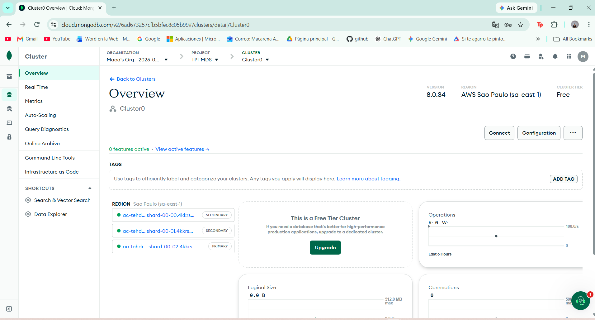

*Figura 1. Clúster configurado para la persistencia en la nube.*

### 5.1. Database Access y Network Access

Se configuró el usuario de base de datos `app_foodstore` y el acceso de red necesario para las pruebas. Las capturas acreditan estas configuraciones, pero **no** acreditan una aplicación del principio de privilegios mínimos: en la evidencia revisada el usuario posee el rol amplio `atlasAdmin` y figura la regla IPv4 `0.0.0.0/0`, que permite conexiones desde cualquier IP sujeta a autenticación.

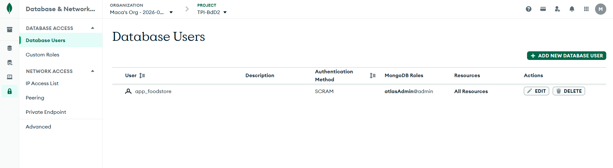

*Figura 2. Cuenta de acceso configurada en Atlas.*

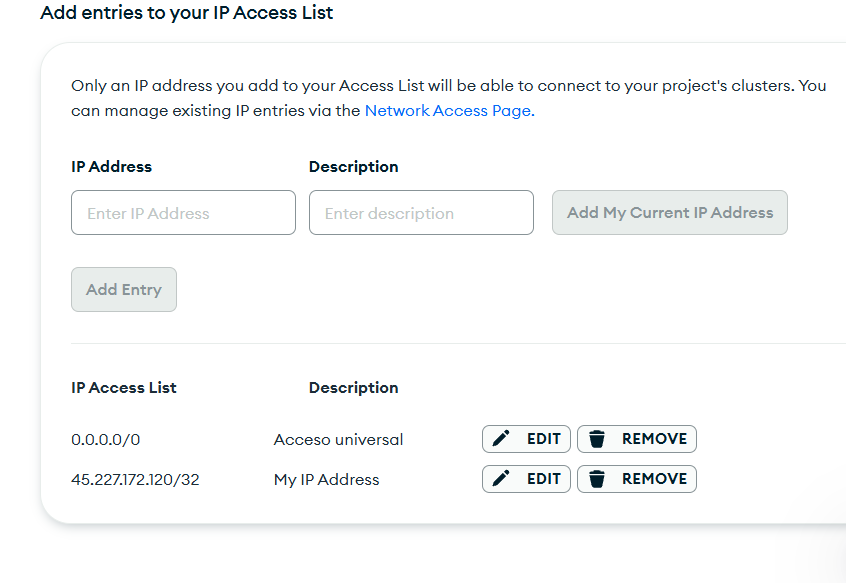

*Figura 3. Network Access utilizado durante las pruebas.*

La cadena de conexión se configura en el archivo local `.env`, que **no forma parte del código fuente ni debe incluirse en el ZIP público**. El archivo `.env.example` conserva únicamente la plantilla. Las credenciales necesarias para la corrección deben compartirse por el canal privado indicado por la cátedra.

### 5.2. Colecciones e índice único

La existencia de documentos en Atlas se documentó con las siguientes capturas:

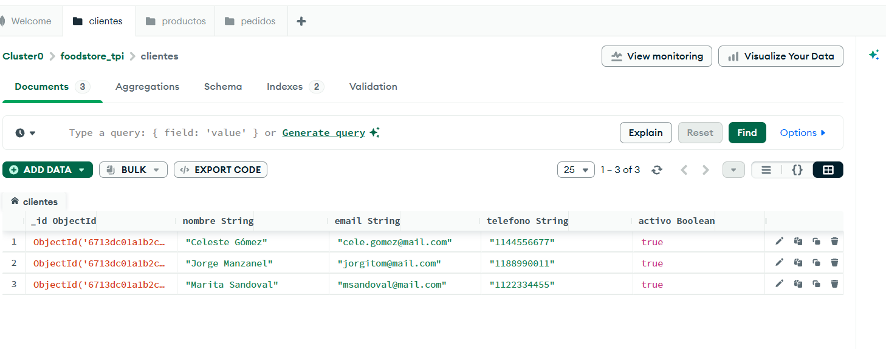.
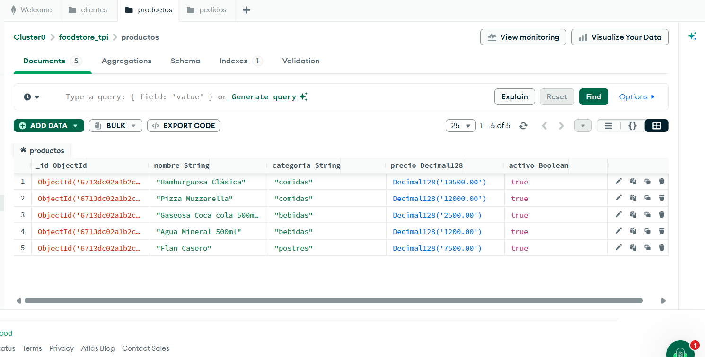.
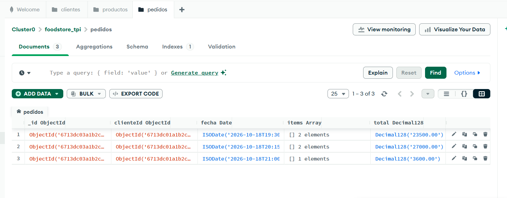.

En `clientes` se definió el índice único `email_1`, que impide duplicar el campo `email`, incluidos los registros con `activo: false`. El índice fue comprobado también después de la restauración.

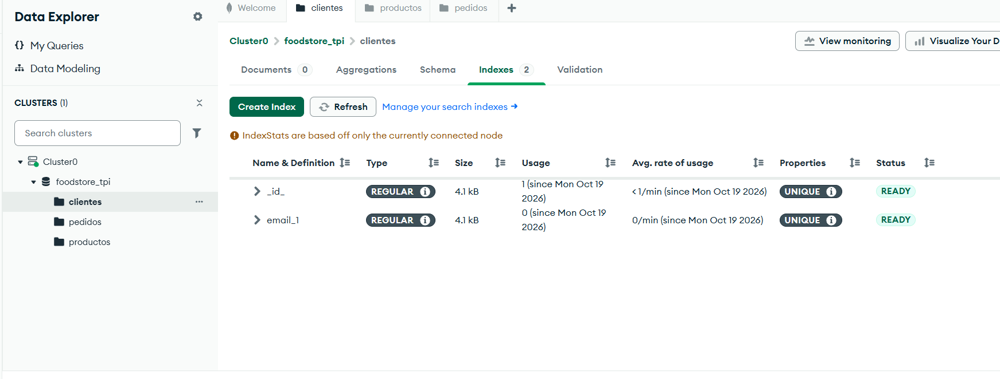

*Figura 4. Restricción de unicidad aplicada en la base de datos.*

## 6. Modelo de datos documental

### 6.1. Esquema de las tres colecciones

| Colección | Campos principales | Tipos destacados |
| --- | --- | --- |
| `clientes` | `_id`, `nombre`, `email`, `telefono`, `activo` | `ObjectId`, `String`, `Boolean` |
| `productos` | `_id`, `nombre`, `categoria`, `precio`, `activo` | `ObjectId`, `String`, `Decimal128`, `Boolean` |
| `pedidos` | `_id`, `clienteId`, `fecha`, `items`, `total`, `estado`, `activo` | `ObjectId`, `Date`, `Array`, `Decimal128`, `Boolean` |
| `pedidos.items[]` | `productoId`, `nombreProducto`, `precioUnitario`, `cantidad`, `subtotal` | `ObjectId`, `String`, `Decimal128`, `Int32` |

Los teléfonos se almacenan como cadenas, ya que no intervienen en cálculos. Los importes utilizan `Decimal128`, mientras que las cantidades de ítems se almacenan como `Int32`.

Estas estructuras describen el modelo de la aplicación; **no se afirma haber configurado validadores `$jsonSchema` en Atlas**.

### 6.2. Ejemplo de cliente en Extended JSON

```json
{
  "_id": { "$oid": "6713dc01a1b2c3d4e5f60001" },
  "nombre": "Cliente Ejemplo",
  "email": "cliente.ejemplo@example.com",
  "telefono": "1100000000",
  "activo": true
}
```

### 6.3. Ejemplo de producto en Extended JSON

```json
{
  "_id": { "$oid": "6713dc02a1b2c3d4e5f60010" },
  "nombre": "Hamburguesa Clásica",
  "categoria": "comidas",
  "precio": { "$numberDecimal": "10500.00" },
  "activo": true
}
```

### 6.4. Ejemplo de pedido en Extended JSON

```json
{
  "_id": {
    "$oid": "6713dc03a1b2c3d4e5f60020"
  },
  "clienteId": {
    "$oid": "6713dc01a1b2c3d4e5f60001"
  },
  "fecha": {
    "$date": "2026-10-18T19:30:00.000Z"
  },
  "items": [
    {
      "productoId": {
        "$oid": "6713dc02a1b2c3d4e5f60010"
      },
      "nombreProducto": "Hamburguesa Clásica",
      "precioUnitario": {
        "$numberDecimal": "10500.00"
      },
      "cantidad": {
        "$numberInt": "2"
      },
      "subtotal": {
        "$numberDecimal": "21000.00"
      }
    }
  ],
  "total": {
    "$numberDecimal": "21000.00"
  },
  "estado": "pendiente",
  "activo": true
}
```

Los tres fragmentos corresponden a **ejemplos ilustrativos**, no a un volcado de la base actual. También están disponibles como archivos de texto: [clientes.json](../datos-ejemplo/clientes.json), [productos.json](../datos-ejemplo/productos.json) y [pedidos.json](../datos-ejemplo/pedidos.json).

### 6.5. Justificación del linking

Los pedidos referencian el cliente mediante `clienteId` y los productos mediante `items[].productoId`. Se utiliza **linking** porque clientes y productos tienen vida propia y pueden aparecer en múltiples pedidos. El modelo evita copiar todos los datos del cliente y del catálogo en cada transacción.

La aplicación verifica la existencia y condición activa de los documentos referenciados antes de crear el pedido. MongoDB no impone estas referencias como claves foráneas; las verificaciones previas y la inserción del pedido no forman una transacción conjunta, por lo que no se declara una garantía frente a modificaciones concurrentes.

### 6.6. Justificación del embedding

Los ítems se almacenan como documentos **embebidos** en `pedidos.items` porque conforman el detalle de una transacción y se consultan junto con ella. Se incluyen una referencia al producto y una copia de `nombreProducto` y `precioUnitario`.

Esta duplicación controlada mantiene los datos del momento de compra: un cambio posterior del precio o la desactivación del producto no modifica el valor histórico del pedido. Esto se verificó en las pruebas `PED-08` y `PED-09`.

El detalle ampliado del diseño se documenta en [Modelo y decisiones de diseño](../modelo/modelo.md).

## 7. Operaciones CRUD y reglas de negocio

### 7.1. Clientes

- **Crear:** registra un cliente con `activo: true` y valida campos obligatorios.
- **Leer:** lista y busca únicamente clientes activos.
- **Modificar:** actualiza campos permitidos del documento.
- **Desactivar:** cambia `activo` a `false` sin eliminar el documento.
- **Unicidad:** normaliza el correo a minúsculas y elimina espacios externos; el índice único impide reutilizarlo, incluso si el titular anterior fue desactivado.

Se verificaron alta y persistencia (`CLI-01`), búsqueda (`CLI-02`), modificación (`CLI-03`), rechazo de duplicados (`CLI-05`), baja lógica (`CLI-08`) y tratamiento de correo de cliente inactivo (`CLI-09`).

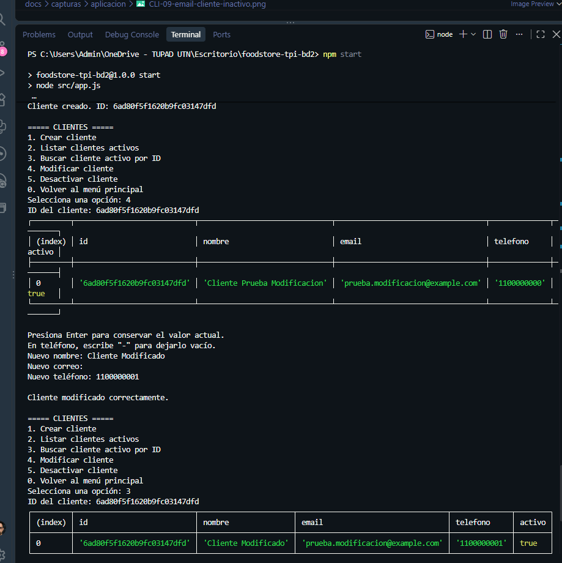

*Figura 5. Evidencia de actualización de clientes.*

### 7.2. Productos

- **Crear y leer:** registra y consulta productos activos.
- **Modificar:** permite actualizar los campos admitidos, incluido el precio.
- **Desactivar:** establece `activo: false` y lo excluye de las búsquedas de activos.
- **Validar:** admite categorías `comidas`, `bebidas` o `postres`, y precios positivos con hasta dos decimales; acepta coma o punto decimal como separador de entrada.

Las capturas `PRO-01` a `PRO-07` muestran las operaciones principales, el rechazo de categorías o importes inválidos y la baja lógica.

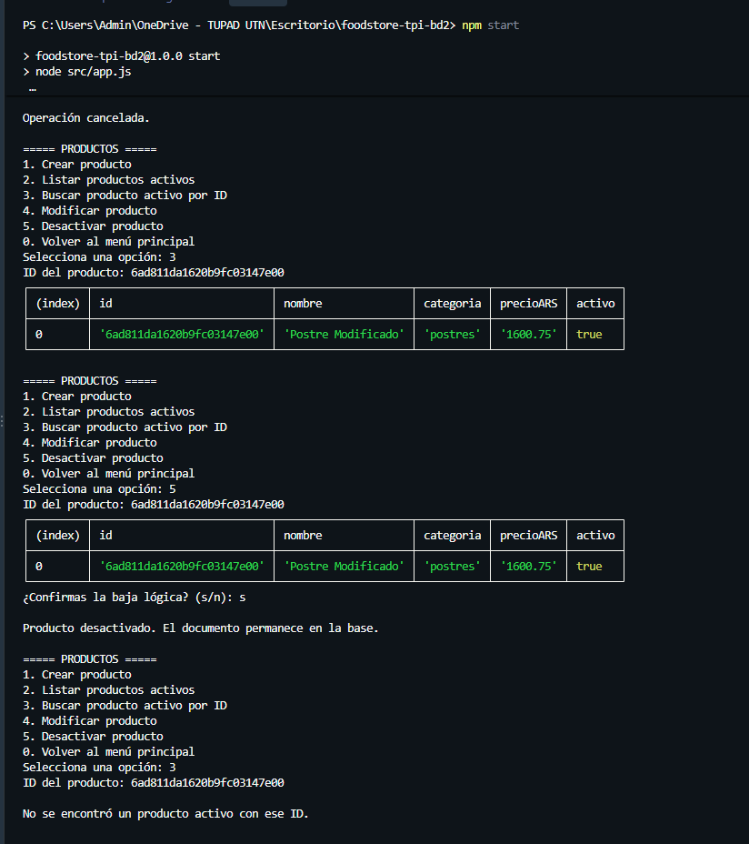

*Figura 6. Cancelación y confirmación de baja lógica de un producto.*

### 7.3. Pedidos

La aplicación comprueba que el cliente y los productos elegidos existan y se encuentren activos. Al crear un pedido calcula el subtotal de cada ítem con `decimal.js`, almacena la cantidad como `Int32` y registra subtotal y total como `Decimal128`.

**Reglas principales:**

- Los pedidos nuevos comienzan en `estado: "pendiente"` y `activo: true`.
- Los estados permitidos después de `pendiente` son `entregado` y `cancelado`; no se permiten cambios posteriores.
- La baja lógica modifica únicamente el indicador `activo` y conserva el pedido con su detalle.
- `estado: "cancelado"` y `activo: false` representan conceptos distintos.

La prueba `PED-02` utilizó dos unidades de ARS 1.250,50 y una unidad de ARS 750,25: ARS 2.501,00 + ARS 750,25 = **ARS 3.251,25**.

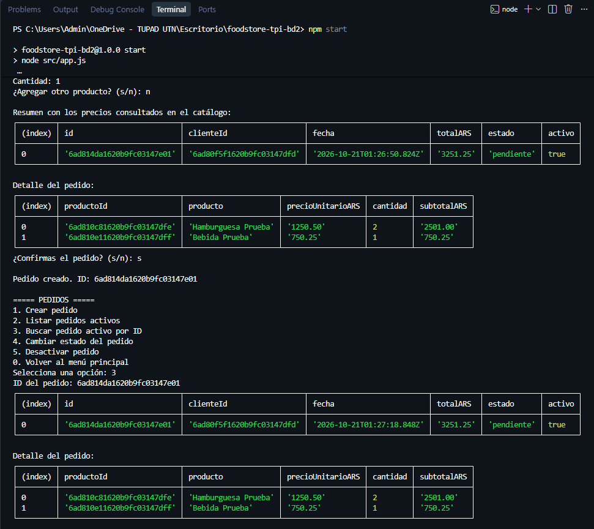

*Figura 7. Pedido de prueba con subtotal y total.*

En `PED-13`, se comprobó posteriormente que el pedido desactivado seguía almacenado en la base principal con `activo: false` y **no aparecía** en el listado de pedidos activos de Food Store. La base de recuperación conservaba una versión anterior en la que figuraba como activo.

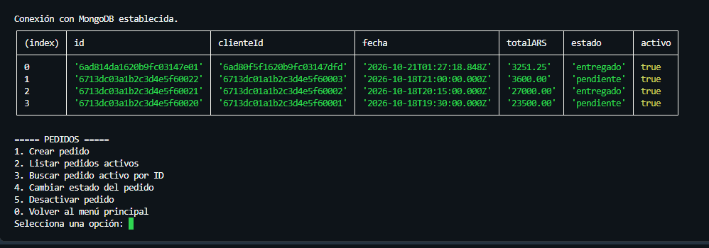

*Figura 8. Consulta de pedidos activos después de la baja lógica.*

### 7.4. Comprobación adicional de integridad

Durante la auditoría se detectó un error en un dato de ejemplo: el pedido terminado en `f60021` tenía una Pizza Muzzarella con `precioUnitario` ARS 1.200,00 y subtotal ARS 12.000,00 para cantidad 1. Después de contrastar el dato con el catálogo y el subtotal, se corrigió controladamente el precio unitario a **ARS 12.000,00**, sin alterar el total del pedido.

A continuación se revisaron los cálculos de todos los pedidos de la base principal con una consulta de solo lectura y aritmética exacta en centavos:

| Indicador | Resultado |
| --- | ---: |
| Pedidos analizados | 5 |
| Pedidos aritméticamente correctos | 5 |
| Inconsistencias detectadas tras la corrección | 0 |

Esta comprobación valida los importes de los cinco pedidos examinados, no todas las reglas de negocio ni la concurrencia entre operaciones.

## 8. Mecanismo de respaldo

### 8.1. Script y funcionamiento

El archivo `scripts/backup.ps1` lee `MONGODB_URI` y `MONGODB_DB` desde el `.env` local, verifica la presencia de `mongodump` y ejecuta el respaldo de toda la base. No filtra por `activo`, por lo que incluye documentos activos e inactivos.

El script utiliza rutas relativas al directorio del proyecto y guarda cada nueva ejecución en:

```text
resguardos_tpi/
  AAAA-MM-DD/
    HH-mm-ss/
      foodstore_tpi/
        clientes.bson
        clientes.metadata.json
        productos.bson
        productos.metadata.json
        pedidos.bson
        pedidos.metadata.json
        prelude.json
      resultado_backup.txt
```

El respaldo original del 20/10/2026 utiliza una carpeta por fecha sin la subcarpeta de hora, porque se generó antes de la mejora. Si `mongodump` falla, el script devuelve un código distinto de cero y la copia parcial no debe considerarse un respaldo válido. Las ejecuciones correctas quedan registradas en `resultado_backup.txt`.

### 8.2. Ejecuciones documentadas

| Fecha y hora local | Duración | Datos informados |
| --- | ---: | --- |
| 20/10/2026, 22:48 | **8,21 s** | 5 clientes, 8 productos, 5 pedidos; 3 BSON; código 0 |
| 21/10/2026, 00:50 | **1,93 s** | 18 documentos; 3 BSON; código 0 |
| 21/10/2026, 01:22 | **2,02 s** | 18 documentos; 3 BSON; código 0; posterior a la corrección del dato |

El primer respaldo ocupó **3.904 bytes (3,81 KB)** en su carpeta de datos, sin contar `resultado_backup.txt`. Estas cifras corresponden al entorno de prueba y pueden variar en futuras ejecuciones.

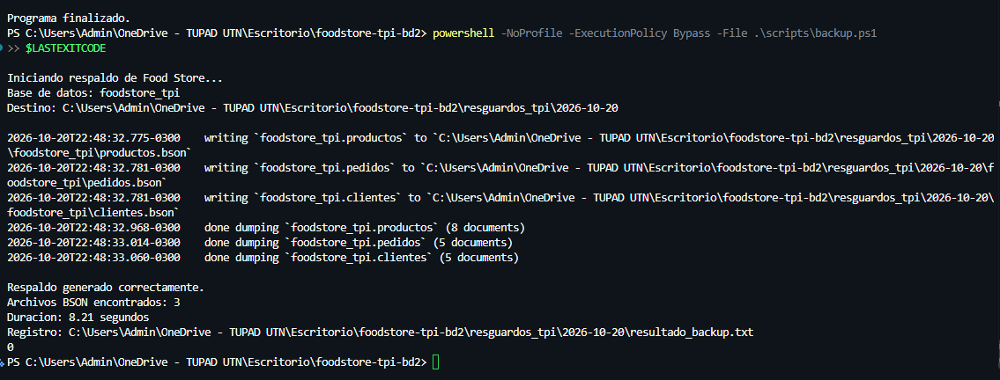

*Figura 9. Ejecución exitosa del script de respaldo.*

## 9. Restauración y comprobación de recuperación

Se realizó una recuperación sobre una base diferente, llamada `foodstore_tpi_restore_test`, **sin sobrescribir `foodstore_tpi`**. La prueba utilizó el respaldo del **20/10/2026**.

El procedimiento incluyó:

1. Localización de los archivos BSON y los metadatos del respaldo.
2. Comprobación de las utilidades MongoDB Database Tools.
3. Simulación `mongorestore --dryRun` para verificar la correspondencia de nombres.
4. Restauración con cambio de namespace de `foodstore_tpi.*` a `foodstore_tpi_restore_test.*`.
5. Comprobación de documentos, colecciones e índice único con `mongosh`.
6. Inicio de Food Store contra la base restaurada y consultas de solo lectura de los tres módulos.

| Indicador de recuperación | Resultado |
| --- | --- |
| Documentos restaurados | **18** |
| Fallos reportados | **0** |
| Distribución | 5 clientes, 8 productos, 5 pedidos |
| Índice de clientes | `email_1` con `unique: true`, verificado |
| Duración de `mongorestore` | **2,43 segundos** |
| Código de salida | **0** |
| Consultas desde la aplicación | 4 clientes activos, 6 productos activos y 5 pedidos activos |

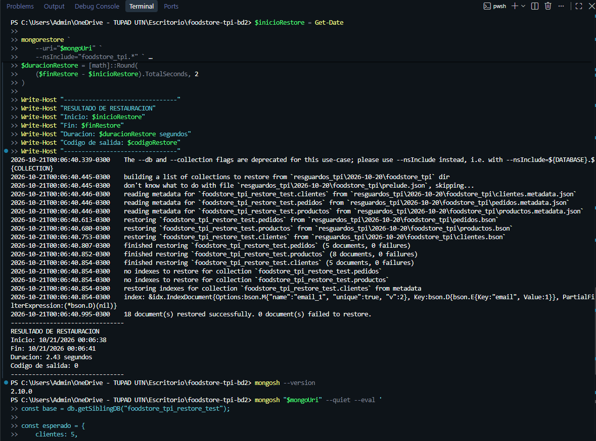

*Figura 10. Restauración real de los 18 documentos en la base de pruebas.*

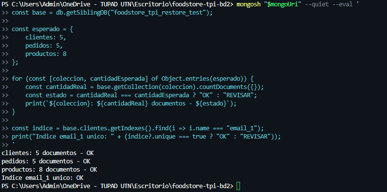

*Figura 11. Consulta de cantidades e índice único recuperado.*

La copia utilizada en esta restauración es anterior a la corrección de Pizza Muzzarella y a la baja lógica posterior del pedido `PED-13`. Por ese motivo, una base restaurada puede presentar valores distintos de la base principal actual. **No se ejecutó una restauración independiente del backup posterior de las 01:22.**

## 10. Objetivos de recuperación RTO y RPO

### 10.1. RPO

El **Recovery Point Objective (RPO)** establece la pérdida máxima tolerable de datos, expresada en tiempo. Para Food Store se propone un **RPO de 24 horas**.

Aunque el script se ejecutó exitosamente en tres ocasiones, su uso actual es **manual**. No existe una tarea periódica supervisada que garantice la existencia de una copia válida con una antigüedad máxima de 24 horas ante cualquier incidente. Por lo tanto, **el objetivo RPO no se considera garantizado**.

### 10.2. RTO

El **Recovery Time Objective (RTO)** representa el tiempo objetivo para restablecer el funcionamiento después de una interrupción. Para el entorno académico se propone un **RTO de 60 minutos**.

Los **2,43 segundos** corresponden al tiempo observado de la herramienta `mongorestore`. No incluyen detección del incidente, localización de la copia, preparación de accesos, verificación de los datos y comprobación final del funcionamiento en un único proceso cronometrado. Por eso **no se afirma que el RTO integral de 60 minutos esté validado**.

El desarrollo de estos conceptos, procedimientos y limitaciones está en [Objetivos de recuperación RTO/RPO](rto-rpo.md).

## 11. Resultados de las pruebas y evidencias

| Área | Resultado comprobado |
| --- | --- |
| Conexión | Atlas accesible desde la aplicación; consultas y operaciones persistentes |
| Clientes | Alta, lectura, modificación, correos duplicados y baja lógica |
| Productos | Alta, lectura, modificación, validaciones y baja lógica |
| Pedidos | Creación, importes, cambios de estado, historial y baja lógica |
| Integridad | 5 pedidos revisados, 0 inconsistencias aritméticas después de corregir el dato |
| Backup | 3 ejecuciones exitosas, con datos de las tres colecciones |
| Recuperación | 18 documentos restaurados y consultados desde Food Store |

El [plan de pruebas](../pruebas/plan-de-pruebas.md) describe los casos y sus criterios; el [registro de ejecución](../pruebas/registro-ejecucion.md) detalla qué fue observado y con qué evidencia. No todos los casos complementarios del catálogo inicial fueron ejecutados, y no se presentan como aprobados.

## 12. Limitaciones y propuestas de mejora

Entre las mejoras identificadas para un entorno real se encuentran:

- Restringir Network Access a los orígenes necesarios y asignar al usuario de aplicación permisos acordes con sus funciones.
- Mantener credenciales privadas y excluir `.env`, respaldos locales, dependencias instaladas e historial Git del ZIP público.
- Programar y supervisar respaldos si se pretende sostener el RPO propuesto; mantener copias independientes y una política de retención.
- Realizar pruebas integrales de recuperación con medición del RTO completo, incluidas comprobaciones de la copia más reciente.
- Incorporar pruebas automatizadas y controles adicionales frente a cambios concurrentes entre validación e inserción de pedidos.

Son **mejoras propuestas**, no funcionalidades que se declaren implementadas o ensayadas.

## 13. Conclusión y reflexión final

Food Store permitió aplicar de manera práctica los conceptos de modelado documental, persistencia Cloud y comunicación cliente-servidor. La separación de clientes, productos y pedidos mediante referencias mantuvo entidades independientes, mientras que el uso de documentos embebidos en `items` permitió conservar el detalle histórico de cada compra y consultarlo como parte del pedido.

La experiencia de desarrollo también mostró la importancia de validar los datos en varios niveles. La aplicación aplica las reglas de negocio, el índice único protege el correo a nivel de base, y las pruebas sobre documentos reales permitieron identificar y corregir una inconsistencia en el precio unitario de un pedido. La baja lógica conservó los documentos sin exponerlos en los listados habituales de activos.

En cuanto a la comunicación cliente-servidor, las pruebas confirmaron que la aplicación Node.js envía operaciones por medio del driver y recibe respuestas de MongoDB Atlas, con datos que permanecen disponibles después del cierre del programa. Las pruebas de respaldo y restauración reforzaron esa verificación al recuperar 18 documentos en otra base y consultarlos nuevamente desde Food Store.

El trabajo requirió coordinar el modelo, la configuración de Atlas, la implementación de los módulos y la documentación de evidencias. El resultado es un proyecto académico funcional dentro del alcance definido. Se identificaron además mejoras necesarias para un uso operativo, especialmente en permisos, automatización y monitoreo de respaldos, recuperación integral y pruebas más extensas. Estas limitaciones se describen explícitamente, sin presentar objetivos o funcionalidades pendientes como si estuvieran comprobados.

---

## 14. Material complementario

Como complemento del presente informe, el repositorio Food Store contiene el codigo fuente de la aplicacion, el modelo documental NoSQL, los ejemplos JSON, el script de respaldo y la documentacion de las pruebas realizadas.

**Informe tecnico final en PDF:** [informe.pdf](informe.pdf) (33 paginas, con evidencias y fragmentos del codigo).

**Repositorio del proyecto:** https://github.com/CastoGil/foodstore-tpi-bd2
